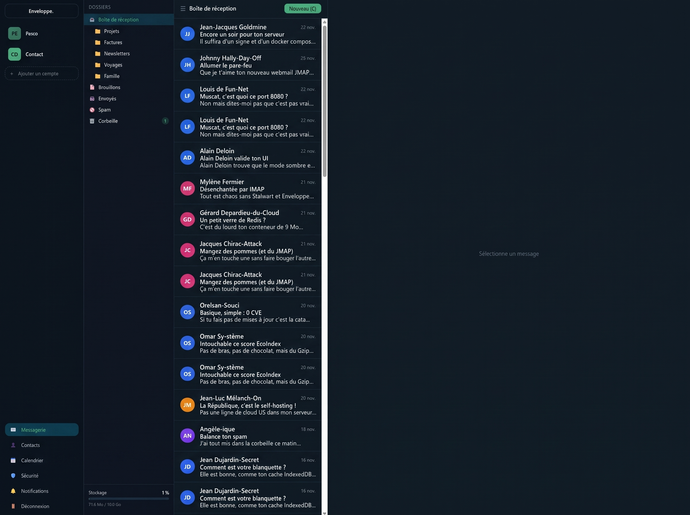

# ✉️ Enveloppe

Webmail **PWA** ultraléger, moderne et 100 % **JMAP** (*Mail, Contacts JSContact, Calendrier JSCalendar*), conçu pour **Stalwart Mail Server** et compatible multi-serveurs.




---

## ✨ Fonctionnalités

* **Messagerie JMAP complète** : gestion des dossiers et sous-dossiers, menus contextuels au clic droit sur les emails (*Archiver, Supprimer, Lu/Non lu, Favori, Spam, Déplacer vers, Exporter en `.eml`, Imprimer*) et sur les dossiers (*Nouveau sous-dossier, Renommer, Supprimer*).
* **Calendrier (JSCalendar)** : vues *Mois*, *Semaine* et *Jour*, création directe au clic sur une date ou une tranche horaire (**Événement** avec invitation de participants, **Tâche**, **Anniversaire** à récurrence annuelle), import/export `.ics` et `.json`.
* **Contacts (JSContact)** : consultation et gestion synchronisée avec le serveur.
* **Sécurité du compte** : changement de mot de passe intégré (API Stalwart) avec déconnexion automatique immédiate.
* **Expérience PWA** : installable sur desktop et mobile, cache hors-ligne (IndexedDB avec persistance navigateur `navigator.storage.persist()`), notifications push (auto-découverte de la clé VAPID du serveur).

---

## 🌱 Sobriété & Green-IT

* **Taille de l'image Docker** : `9,84 Mo` (binaire Go statique sur `distroless/static-debian12:nonroot`).
* **Empreinte mémoire** : `~5,9 Mio` de RAM (`0,00 %` CPU au repos).
* **Réseau optimisé** : compression **Gzip** native, cache immuable (`max-age=31536000, immutable`) sur les assets statiques et requêtes JMAP groupées.

---

## 🏗️ Architecture & Persistance

Enveloppe repose sur un **BFF (Backend-for-Frontend) en Go** qui sert l'interface **Svelte/Vite** et proxyfie les appels JMAP vers votre serveur de messagerie.

* **Backend 100 % *stateless*** : aucun volume Docker n'est requis, le conteneur tourne en lecture seule (`read_only: true`).
* **Données persistantes** : vos emails, dossiers, contacts et calendriers restent exclusivement sur votre serveur Stalwart. Tant que la variable `SESSION_SECRET` est conservée, les sessions survivent aux mises à jour du conteneur.
* **Cache local** : les préférences et le cache hors-ligne sont stockés dans le navigateur (`localStorage` + `IndexedDB`).

---

## 🚀 Déploiement rapide (Docker Compose)

### 1. Récupérer les fichiers

```bash
mkdir enveloppe && cd enveloppe
curl -O [https://raw.githubusercontent.com/boris22100/enveloppe/main/docker-compose.yml](https://raw.githubusercontent.com/boris22100/enveloppe/main/docker-compose.yml)
curl -O [https://raw.githubusercontent.com/boris22100/enveloppe/main/.env.example](https://raw.githubusercontent.com/boris22100/enveloppe/main/.env.example)
```

### 2. Configurer l'environnement

```bash
cp .env.example .env
sed -i "s/remplace_moi_par_une_chaine_aleatoire_longue/$(openssl rand -hex 32)/" .env
```

Éditez `.env` pour adapter votre URL publique :

| Variable | Description | Exemple |
| :--- | :--- | :--- |
| `PUBLIC_APP_URL` | URL HTTPS publique de votre instance | `https://webmail.mondomaine.fr` |
| `SESSION_SECRET` | Clé secrète (64 caractères hex) utilisée pour chiffrer les cookies de session en AES-GCM | *(générée via `openssl rand -hex 32`)* |
| `ALLOWED_JMAP_SERVERS` | Domaines JMAP autorisés (`*` pour tous, ou liste séparée par des virgules pour restreindre) | `mail.mondomaine.fr` |

### 3. Lancer le conteneur

```bash
docker compose up -d
```

L'application écoute sur `http://127.0.0.1:8080`. Exposez-la impérativement en **HTTPS** derrière votre reverse-proxy (Traefik, Nginx, Caddy, Pangolin...) afin d'activer les cookies `Secure` et l'installation PWA.

> **Note SSO (Pangolin, Authelia, Authentik...)** : si vous placez Enveloppe derrière un portail SSO, pensez à autoriser le chemin `/manifest.webmanifest` (ou à laisser les credentials actifs) pour éviter les erreurs CORS au chargement de la PWA.

### Mise à jour

```bash
docker compose pull && docker compose up -d
```

---

## 🛡️ Sécurité & Audit

### Mesures intégrées
* **Sessions chiffrées** : identifiants stockés uniquement dans un cookie chiffré en **AES-GCM** côté client avec les drapeaux `HttpOnly`, `Secure` et `SameSite`.
* **Isolation du conteneur** : image Distroless sans shell, utilisateur non-root, système de fichiers `read_only: true`, `no-new-privileges:true`.
* **Durcissement HTTP** : en-têtes `Content-Security-Policy`, `Strict-Transport-Security`, `X-Content-Type-Options: nosniff`, `X-Frame-Options: DENY`, `Referrer-Policy: no-referrer` et `Permissions-Policy`.
* **Proxy sécurisé** : timeouts HTTP serveur (`ReadHeaderTimeout`, `IdleTimeout`), non-propagation du header `Authorization` sur redirection cross-domain, sanitisation des logs.

### Résultats de l'audit automatisé

| Outil | Périmètre analysé | Résultat |
| :--- | :--- | :--- |
| **Trivy** | Image Docker finale (`debian 12.15` + binaire Go) | **0** vulnérabilité (`HIGH` / `CRITICAL`) |
| **govulncheck** | Code source et dépendances Go | **0** vulnérabilité |
| **npm audit** | Dépendances de production Frontend | **0** vulnérabilité |
| **Gitleaks** | Historique Git complet | **0** secret exposé |
| **OWASP ZAP** | Scan passif en production (HTTPS) | **0 FAIL** / **63 PASS** *(5 WARN informatifs attendus pour une PWA webmail)* |

---

## 📦 Image officielle

```
ghcr.io/boris22100/enveloppe:latest
```

## 📄 Licence

Distribué sous licence **MIT**. Voir `LICENSE` pour plus d'informations.
