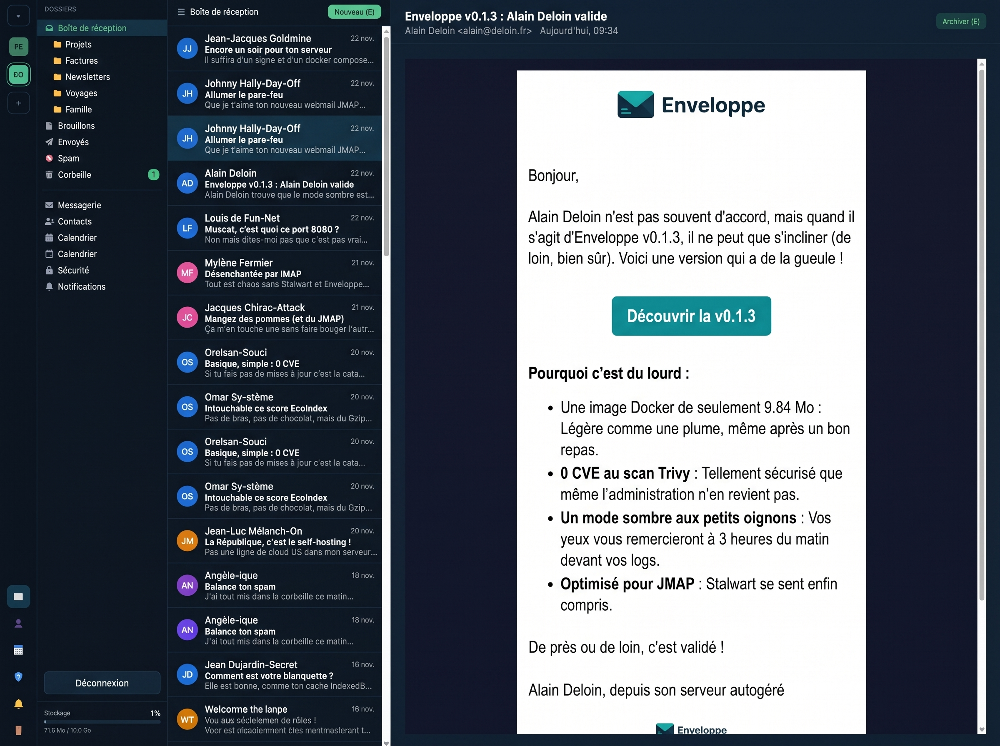
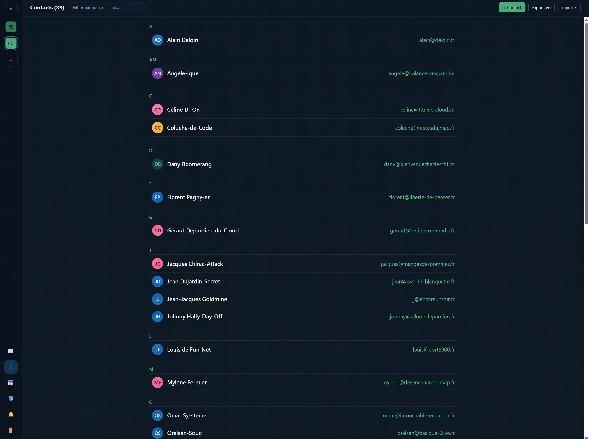
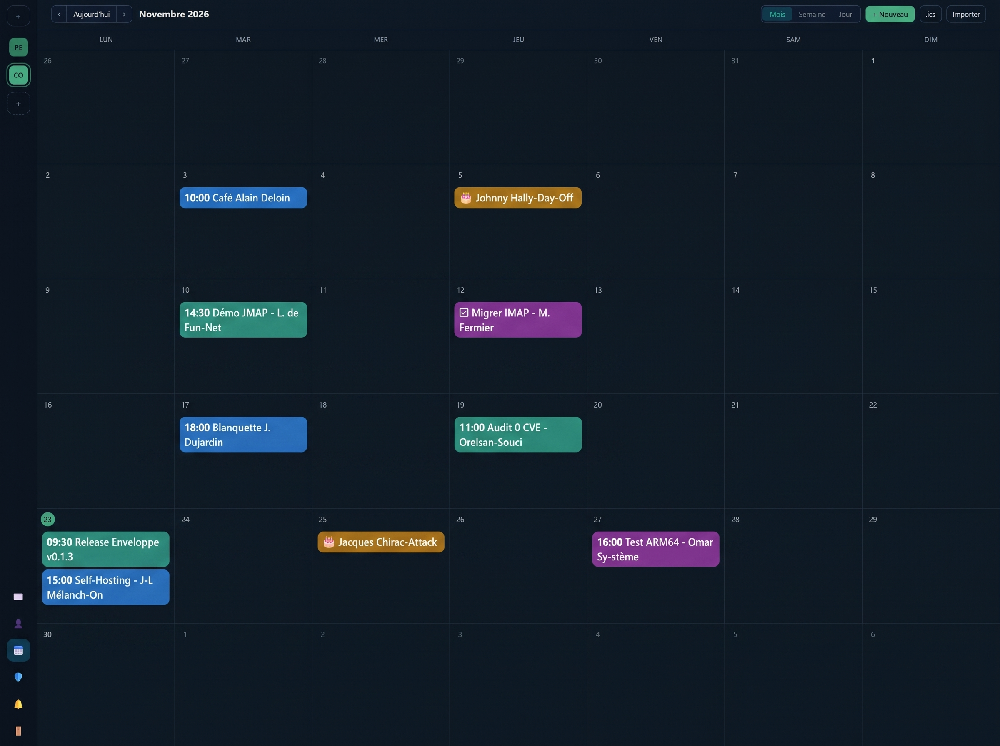

# ✉️ Enveloppe

Webmail **PWA** ultraléger, moderne et 100 % **JMAP** (*Mail, Contacts JSContact, Calendrier JSCalendar*), conçu pour **Stalwart Mail Server** et compatible multi-serveurs.


> 📖 **Documentation complète** : consultez le **[Wiki Enveloppe](https://github.com/boris22100/enveloppe/wiki)** pour les guides détaillés d'[installation](https://github.com/boris22100/enveloppe/wiki/Installation), de [configuration avec ou sans SSO](https://github.com/boris22100/enveloppe/wiki/Configuration) et d'[utilisation](https://github.com/boris22100/enveloppe/wiki/Utilisation).

| Messagerie | Contacts | Agenda |
| :---: | :---: | :---: |
|  |  |  |

---

## ✨ Fonctionnalités

* **Connexion OIDC / SSO automatique (PKCE)** : saisie de l'URL du serveur JMAP, détection automatique de `/.well-known/openid-configuration`, support **Authorization Code + PKCE (`S256`)** avec rafraîchissement transparent des jetons et support **CIMD** (`/oauth-client.json`). La connexion par identifiant/mot de passe d'application reste disponible en secours.
* **Messagerie JMAP complète** : gestion des dossiers et sous-dossiers, menus contextuels au clic droit sur les emails (*Archiver, Supprimer, Lu/Non lu, Favori, Spam, Déplacer vers, Exporter en `.eml`, Imprimer*) et sur les dossiers (*Nouveau sous-dossier, Renommer, Supprimer*).
* **Calendrier (JSCalendar)** : vues *Mois*, *Semaine* et *Jour*, création directe au clic sur une date ou une tranche horaire (**Événement** avec invitation de participants, **Tâche**, **Anniversaire** à récurrence annuelle), import/export `.ics` et `.json`.
* **Contacts (JSContact)** : consultation et gestion synchronisée avec le serveur.
* **Recherche instantanée, filtres et fils de discussion** : filtrage en direct (expéditeur, objet, aperçu, *Non lus*, *PJ*) et regroupement par fil (`threadId`) avec navigation dans la conversation.
* **Réponse, transfert et signatures par compte** : actions *Répondre*, *Répondre à tous* et *Transférer* avec citation automatique, raccourcis clavier (`R`, `A`, `F`) et signatures dédiées par compte.
* **Trois thèmes harmonisés (Abysses, Sombre, Clair)** : sélecteur instantané dans le rail latéral sur la même charte graphique, persisté localement et adapté au lecteur d'emails.
* **Interface adoucie et accessibilité (`a11y`)** : panneaux flottants arrondis, espacement et typographie confortables, focus clavier visible, attributs ARIA et labels associés.
* **Filtres serveur Sieve (JMAP RFC 9661)** : éditeur hybride façon *SievePad* combinant un constructeur visuel de règles (*Conditions → Actions* + répondeur *Vacances*) et un éditeur de code Sieve brut avec coloration syntaxique, modèles prêts à l'emploi, validation syntaxique auprès de Stalwart et gestion multi-scripts.
* **Sécurité du compte** : changement de mot de passe intégré (API Stalwart) avec déconnexion automatique immédiate.
* **Expérience PWA** : installable sur desktop et mobile, cache hors-ligne (IndexedDB avec persistance navigateur `navigator.storage.persist()`), notifications push (auto-découverte de la clé VAPID du serveur).

---

## 🌱 Sobriété & Green-IT

* **Taille de l'image Docker** : `9,95 Mo` (binaire Go statique sur `distroless/static-debian12:nonroot`, multi-arch `linux/amd64` & `linux/arm64`).
* **Empreinte mémoire** : `8,04 Mio` de RAM (`0,00 %` CPU au repos).
* **Réseau optimisé** : compression **Gzip** native, cache immuable (`max-age=31536000, immutable`) sur les assets statiques et requêtes JMAP groupées.

---

## 🏗️ Architecture & Persistance

Enveloppe repose sur un **BFF (Backend-for-Frontend) en Go** qui sert l'interface **Svelte/Vite** et proxyfie les appels JMAP vers votre serveur de messagerie.

* **Backend 100 % *stateless*** : aucun volume Docker n'est requis, le conteneur tourne en lecture seule (`read_only: true`).
* **Données persistantes** : vos emails, dossiers, contacts et calendriers restent exclusivement sur votre serveur Stalwart. Tant que la variable `SESSION_SECRET` est conservée, les sessions survivent aux mises à jour du conteneur.
* **Cache local** : les préférences et le cache hors-ligne sont stockés dans le navigateur (`localStorage` + `IndexedDB`).

---

## 🚀 Déploiement rapide (Docker Compose)

### 1. Récupérer les fichiers

```bash
mkdir enveloppe && cd enveloppe
curl -O [https://raw.githubusercontent.com/boris22100/enveloppe/main/docker-compose.yml](https://raw.githubusercontent.com/boris22100/enveloppe/main/docker-compose.yml)
curl -O [https://raw.githubusercontent.com/boris22100/enveloppe/main/.env.example](https://raw.githubusercontent.com/boris22100/enveloppe/main/.env.example)
```

### 2. Configurer l'environnement

```bash
cp .env.example .env
sed -i "s/remplace_moi_par_une_chaine_aleatoire_longue/$(openssl rand -hex 32)/" .env
```

Éditez `.env` pour adapter votre configuration :

| Variable | Description | Exemple / Défaut |
| :--- | :--- | :--- |
| `PUBLIC_APP_URL` | URL HTTPS publique de votre instance | `https://webmail.mondomaine.fr` |
| `SESSION_SECRET` | Clé secrète (64 caractères hex) pour chiffrer les cookies de session en AES-GCM | *(générée via `openssl rand -hex 32`)* |
| `ALLOWED_JMAP_SERVERS` | Domaines JMAP autorisés (`*` pour tous, ou liste séparée par des virgules) | `mail.mondomaine.fr` |
| `OIDC_USE_CIMD` | *(Optionnel)* Utilise l'URL `https://<PUBLIC_APP_URL>/oauth-client.json` comme `client_id` (CIMD) | `false` *(défaut)* |
| `OIDC_CLIENT_ID` | *(Optionnel)* Identifiant d'un client OAuth2 déclaré manuellement dans Stalwart (prioritaire sur CIMD) | `enveloppe` *(défaut)* |
| `OIDC_CLIENT_SECRET` | *(Optionnel)* Secret client uniquement pour un client confidentiel (inutile en PKCE public) | *(vide par défaut)* |

### 3. Activer la connexion OIDC dans Stalwart (Optionnel)

Deux modes sont possibles selon votre préférence :

#### Option A — Automatique via CIMD (sans créer de client)
1. Dans `.env`, ajoutez `OIDC_USE_CIMD=true`.
2. Dans Stalwart (**Settings → OAuth2 → Client Registration**), passez **Client ID Metadata Documents** sur **`Same domain only`** (si Enveloppe et Stalwart partagent le même domaine racine) ou **`Any HTTPS URL`**.
3. *(Optionnel, pour retirer le badge « Unverified application » et afficher votre logo)* : dans **Settings → OAuth2 → Create OAuth client**, pré-enregistrez `https://<votre-domaine>/oauth-client.json` comme **Client ID**, renseignez `Enveloppe` dans **Description**, ajoutez un logo en `data:image/...`, la Redirect URI `https://<votre-domaine>/api/auth/oidc/callback` et les scopes **Mail**, **Contacts**, **Calendars**.

#### Option B — Client OAuth classique
1. Laissez `OIDC_USE_CIMD` désactivé (le `client_id` par défaut est `enveloppe`).
2. Dans Stalwart (**Settings → OAuth2 → Create OAuth client**) :
   * **Client ID** : `enveloppe` (laissez **Client Secret** vide pour PKCE public) et **Description** : `Enveloppe`.
   * **Redirect URIs** : `https://<votre-domaine>/api/auth/oidc/callback` (puis cliquez sur `+`).
   * **Allowed Scopes** : cochez **Mail**, **Contacts** et **Calendars**.
   * **Allowed Grant Types** : laissez cochés **Authorization code** et **Refresh token**.

### 4. Lancer le conteneur

```bash
docker compose up -d
```

L'application écoute sur le port `8080` du conteneur (mappé sur `8089` par défaut dans `docker-compose.yml` — adaptez le port et le réseau à votre reverse-proxy). Exposez-la impérativement en **HTTPS** afin d'activer les cookies `Secure`, OIDC et l'installation PWA.

> **Note SSO (Pangolin, Authelia, Authentik...)** : si vous placez Enveloppe derrière un portail SSO, autorisez l'accès public à `/manifest.webmanifest` (et à `/oauth-client.json` si vous utilisez CIMD) afin que le navigateur et Stalwart puissent les lire sans blocage.

### Mise à jour

```bash
docker compose pull && docker compose up -d
```

---

## 🛡️ Sécurité & Audit

### Mesures intégrées
* **Sessions chiffrées** : identifiants ou jetons OAuth2 (`access_token` / `refresh_token`) stockés uniquement dans un cookie chiffré en **AES-GCM** côté client (`HttpOnly`, `Secure`, `SameSite=Lax`).
* **Isolation du conteneur** : image Distroless sans shell, utilisateur non-root, système de fichiers `read_only: true`, `no-new-privileges:true`.
* **Durcissement HTTP** : `Content-Security-Policy`, `Strict-Transport-Security`, `X-Content-Type-Options: nosniff`, `X-Frame-Options: DENY`, `Referrer-Policy: no-referrer` et `Permissions-Policy`.
* **Proxy sécurisé** : timeouts HTTP serveur (`ReadHeaderTimeout`, `IdleTimeout`), non-propagation du header `Authorization` sur redirection cross-domain, sanitisation des logs.

### Résultats de l'audit automatisé

| Outil | Périmètre analysé | Résultat |
| :--- | :--- | :--- |
| **Trivy** | Image Docker finale (`debian 12.15` + binaire Go) | **0** vulnérabilité (`HIGH` / `CRITICAL`) |
| **govulncheck** | Code source et dépendances Go | **0** vulnérabilité |
| **npm audit** | Dépendances de production Frontend | **0** vulnérabilité |
| **Gitleaks** | Historique Git complet | **0** secret exposé |
| **OWASP ZAP** | Scan passif en production (HTTPS) | **0 FAIL** / **63 PASS** *(5 WARN informatifs attendus pour une PWA webmail)* |

---

## 📦 Image officielle

```
ghcr.io/boris22100/enveloppe:latest
```

## 📄 Licence

Distribué sous licence **MIT**. Voir `LICENSE` pour plus d'informations.
